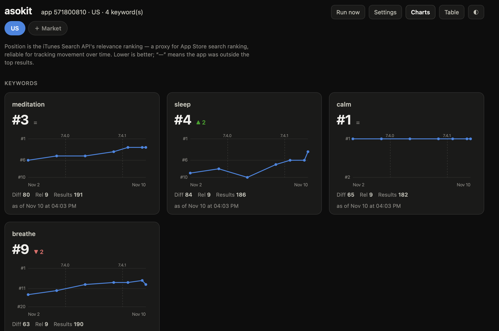
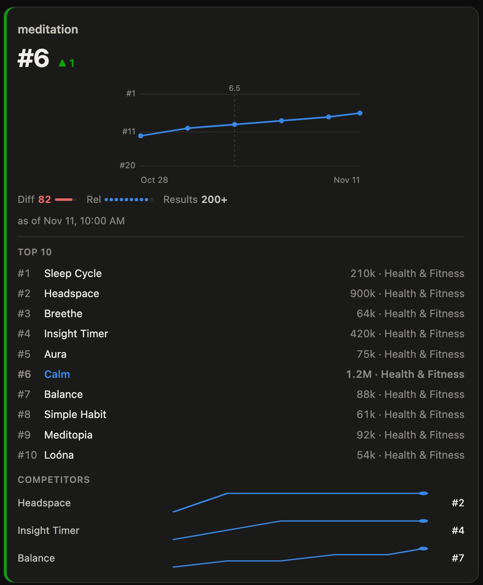

# asokit

[](https://github.com/omervaroglu/asokit/actions/workflows/ci.yml)
[](https://pkg.go.dev/github.com/omervaroglu/asokit)
[](LICENSE)

**asokit** is a small command-line tool (two direct dependencies) that tracks
where an app ranks in App Store search for a set of keywords, over time. It
stores each measurement locally in SQLite so you can watch keywords move up and
down.

It's built for App Store Optimization (ASO) work: pick the keywords you care
about, run `asokit run` on a schedule, and see the trend — in the terminal or in
the built-in web dashboard (`asokit serve`).



```
$ asokit report --trend
KEYWORD     POSITION  TREND  AS OF
calm        #1        =      2026-11-06 12:12
meditation  #3        ▲ 2     2026-11-06 12:12
sleep       #4        ▼ 1     2026-11-06 12:12
```

## How ranking is measured (and its limits)

asokit reads results from Apple's public [iTunes Search API][search-api] and
records the position of your app for each keyword.

**Important:** the Search API returns a *relevance* ordering of apps. It is
**not** the exact, personalized, ad-influenced ranking a user sees in the App
Store app. Treat the position asokit reports as a **ranking proxy** — it is
reliable for tracking *movement over time* for a keyword, but it is not an
absolute "you are #N in the App Store" number. This is a deliberate trade-off:
the Search API is free, needs no account, and works for any app.

Because fetches are capped at 200 results, "not in top results" means your app
was not in the top 200 for that term — not that it is entirely unranked. A term
that returns the full 200 is shown as **"200+"**, since 200 is a ceiling, not a
true total; a term returning fewer is a *narrower*, lower-competition term.

asokit does **not** report search *volume* or *popularity*. The only legitimate
source for that is Apple Search Ads' popularity score, which is out of scope
here. No column or field is a volume estimate.

## Competition metrics

On each run asokit also keeps the top results per keyword (configurable via
`store_top`, default 50) and derives two scores, stored per snapshot. They are
**heuristics for comparing keywords and tracking change over time**, not
official Apple data.

- **Difficulty (0–100)** — how contested a term looks, from its top-10
  landscape. A weighted blend (defaults in [`internal/metrics`](internal/metrics/metrics.go),
  overridable) of: the median rating count (log-scaled, weight 0.5), the share
  of top-10 titles that contain the term (0.3), and the median app age (0.2).
  Higher = harder.
- **Relevance (0–10)** — how on-topic the term is for *your* app: how many of
  the top 10 (excluding you) are the same type, i.e. share your App Store
  category or carry one of your `title_terms`. Higher = the top results are
  genuinely your category.

You can also list **competitors** and see their rank per keyword (derived from
the stored results, no extra requests). See [`asokit.example.yaml`](asokit.example.yaml)
for all fields. Title matching is Unicode-safe (Turkish dotted/dotless i, German
umlaut/ß, CJK).

Click any keyword on the dashboard to expand its detail: the current top 10 (with
your app highlighted) and each competitor's rank over time.



> Screenshots use the demo app [Calm](https://apps.apple.com/app/id571800810) with neutral keywords.

### Keywords vs. phrases

Each market can split its terms into two groups: **keywords** (single words like
`calm`) and **phrases** (multi-word searches like `sleep sounds`). They are
**searched identically** — both go to the same API call and get the same metrics;
the split only changes how they are grouped in the report and dashboard. The point
is readability and ASO strategy: single keywords are broad and contested, while
phrases are longer-tail — fewer rivals, clearer intent — so keeping them apart lets
you see at a glance where you fight for position and where you win easily. Moving a
term between the two groups never affects its metrics.

```
$ asokit report --competitors
KEYWORD       POSITION  DIFF  REL  RESULTS  Headspace  AS OF
meditation    #3        80    9    200+     #2         2026-11-10 14:19
sleep sounds  #7        77    9    188      —          2026-11-10 14:19
```

## Install

With Go 1.26+:

```bash
go install github.com/omervaroglu/asokit/cmd/asokit@latest
```

Or build from source:

```bash
git clone https://github.com/omervaroglu/asokit
cd asokit
make build        # produces ./asokit
```

## Usage

1. Create a config from the example:

   ```bash
   cp asokit.example.yaml asokit.yaml
   ```

   ```yaml
   app_id: 571800810       # the "id" from the App Store URL (shared across markets)
   markets:
     - country: us         # one entry per storefront, each with its own keywords
       keywords:
         - meditation
         - sleep
         - calm
     - country: de
       keywords:
         - meditation
         - schlaf
   ```

   The same app is often marketed with different keywords per country/language,
   so each **market** (storefront) has its own keyword list and its own history.
   (Old single-market configs with a top-level `country:` + `keywords:` are read
   and migrated automatically.)

2. Take a measurement — this fetches each keyword and stores a snapshot:

   ```bash
   asokit run
   ```

3. See the latest positions, or the movement since the previous run:

   ```bash
   asokit report
   asokit report --trend
   ```

### Commands

| Command          | Description                                                      |
| ---------------- | ---------------------------------------------------------------- |
| `asokit run`     | Fetch and store the current position for every keyword in config |
| `asokit once`    | One-off lookup of a single term without touching the database    |
| `asokit report`  | Latest position per keyword, with difficulty/relevance/results columns (`--trend` for movement, `--competitors` for competitor ranks, `--compare YYYY-MM-DD` to diff against an earlier run, `--country xx` to pick a market) |
| `asokit export`  | Export all stored snapshots as CSV, incl. difficulty/relevance/narrow (`--out file.csv`) |
| `asokit serve`   | Serve the local web dashboard (default `http://localhost:8080`)  |
| `asokit version` | Print the version                                                |

Quick one-off without a config file:

```bash
asokit once --app-id 571800810 --country us "meditation"
# term="meditation" app=571800810 country=us -> #3 (of 192 results)
```

### Flags

- `--config` (default `asokit.yaml`) — config path
- `--db` (default `asokit.db`) — SQLite database path
- `--delay` (default `3s`, `run` only) — pause between keyword requests to stay
  friendly to the API. On throttling (HTTP 429/403) **and** transient failures
  (timeouts, HTTP 5xx) asokit backs off and retries, so one flaky request
  doesn't drop a keyword from the run.

## Web dashboard

You can run the whole thing from the browser — no config file editing, no
terminal commands after `serve`:

```bash
asokit serve                       # http://localhost:8080 (loopback only)
asokit serve --addr 127.0.0.1:9000 # custom port
```

On first launch, if there's no config yet, the dashboard opens a **setup form**:
enter the App Store ID, country and keywords, and **Save** (this writes
`asokit.yaml`). Then click **Run now** to fetch the current positions. **Settings**
reopens the form later. If you prefer the terminal, `asokit run` and a
hand-written `asokit.yaml` work exactly the same — they share one config file.

**Multiple markets:** the tabs at the top switch storefronts (TR · DE · …).
**＋ Market** adds another country with its own keywords; each market keeps its
own charts and history, so adding Germany never touches your Turkey data.
"Run now" fetches the market you're viewing.

It's a single self-contained page (HTML/CSS/SVG, no build step, no external
assets — everything is embedded in the binary). Each keyword gets a small
"rank over time" chart with the current position, movement and the difficulty /
relevance / results metrics; click a card for its top-10 and competitor
sparklines. App version dates are drawn as dashed markers on the charts. A
sortable Table view and light/dark themes are built in.

> The server binds to loopback (`127.0.0.1`) by default and writes files /
> makes outbound requests on your behalf — expose it beyond localhost only if
> you understand that.

## Running on a schedule

Because asokit writes to a local SQLite file, you can run it from `cron`:

```cron
0 9 * * *  cd /path/to/project && /usr/local/bin/asokit run >> asokit.log 2>&1
```

A GitHub Actions workflow that runs daily and commits a CSV export is included
as a template at [`.github/workflows/track.yml`](.github/workflows/track.yml)
(disabled by default — enable the `schedule` trigger when you're ready).

## Development

```bash
make test      # run tests
make lint      # go vet + golangci-lint (if installed)
make build     # build ./asokit
```

## License

[MIT](LICENSE) © Ömer Faruk Varoğlu

[search-api]: https://performance-partners.apple.com/search-api
